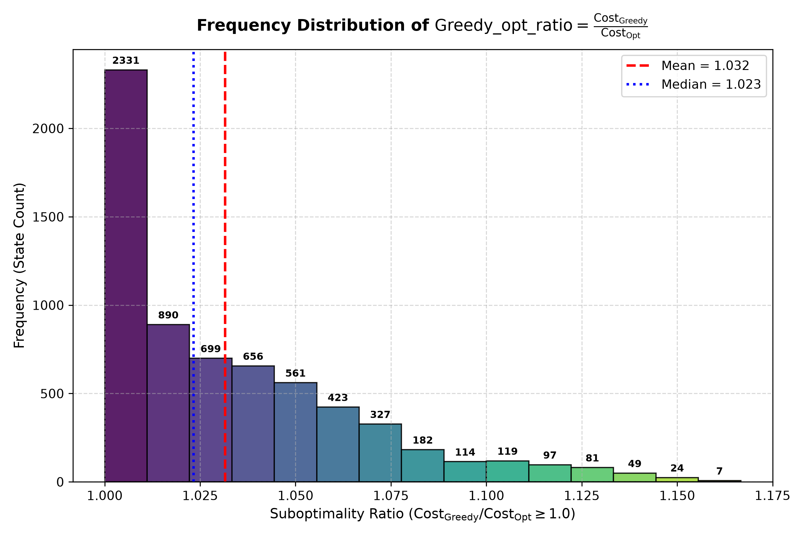
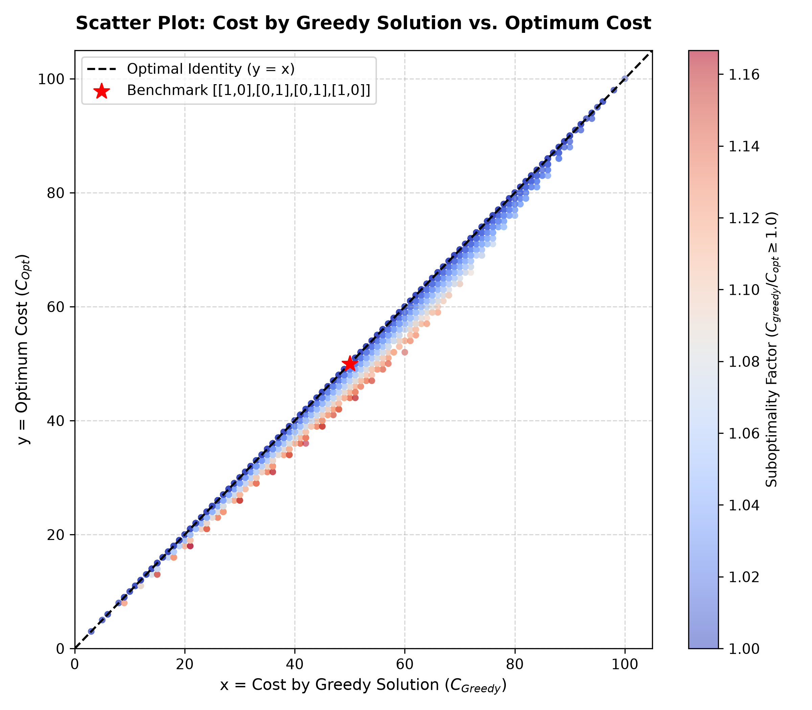
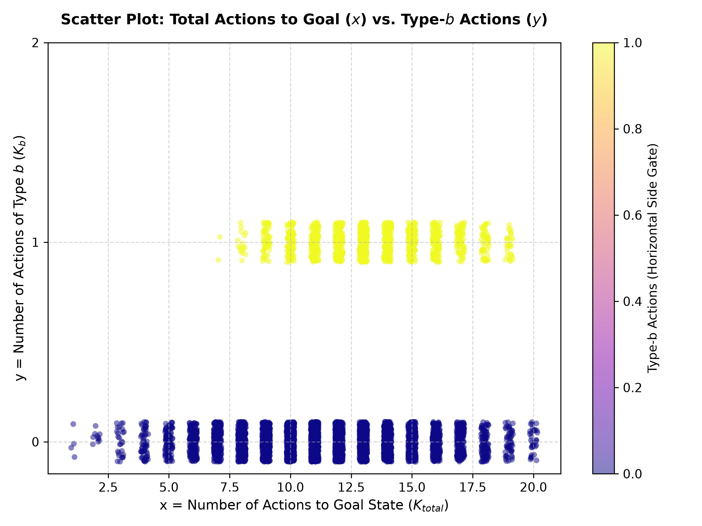

# گزارش جامع علمی و تحلیلی پروژه ۲: معمای جعبه‌های شن
## طراحی تابع آروینی با رگرسیون خطی، پیاده‌سازی الگوریتم‌های جستجوی آگاهانه (*A و RBFS) و برآورد ضریب انشعاب مؤثر ($b^*$)

**نگارش**: تیم توسعه سیستم‌های هوشمند و تحلیل الگوریتم‌ها  
**تاریخ**: نوامبر ۲۰۲۶  
**مخاطب**: استاد محترم درس هوش مصنوعی و دستیاران آموزشی  
**مخزن کد پروژه**: `sandboxes-puzzle` (شاخه: `project2-heuristic-regression`)  

---

## ۱. چکیده و هدف پروژه (Abstract & Executive Summary)

در ادامه تحلیل معمای جعبه‌های شن (**Sandboxes Puzzle**)، این پروژه بر روی **طراحی، پیاده‌سازی و ارزیابی توابع آروینی (Heuristics)** با استفاده از دو رهیافت بنیادین هوش مصنوعی تمرکز دارد:
1. **تکنیک واهلش مسئله (Problem Relaxation)** و اثبات ریاضی پذیرفتنی بودن (Admissibility) و سازگاری (Consistency).
2. **یادگیری تابع آروینی از تجربه با استفاده از رگرسیون خطی (Linear Regression Heuristic Learning)** منطبق بر استاندارد فصل ۳ کتاب مرجع راسل و نورویگ (*Russell & Norvig, AIMA*).

علاوه بر این، در این گزارش شاخص‌های عملکردی کلیدی زیر به صورت جامع و تجربی بر روی کل فضای حالت ($3^8 = 6561$ حالت برای ۴ سطر و $3^{10} = 59049$ حالت برای ۵ سطر) محاسبه، جدول‌بندی و ترسیم شده‌اند:
- **برآورد ضریب انشعاب مؤثر ($b^*$)** با دو فرمول: فرمول تدریس‌شده در **اسلاید ۴۱** استاد ($b^* = \sqrt[d]{N}$) و فرمول استاندارد چندجمله‌ای کتاب راسل و نورویگ با حل ریشه‌یابی عددی.
- **شمارش فراوانی و نمودار هیستوگرام** نسبت بیشینه غیربهینگی حریصانه:
  $$\text{Greedy\_opt\_ratio} = \frac{\text{Cost by Greedy Solution}}{\text{Optimum Cost}}$$
- **نمودار پراکندگی (Scatter Plot ۱)** برای زوج کمیت‌های:
  $$x = \text{Cost by Greedy Solution}, \quad y = \text{Optimum Cost}$$
- **نمودار پراکندگی (Scatter Plot ۲)** برای زوج کمیت‌های:
  $$x = \text{Number of Actions to Goal State}, \quad y = \text{Number of Actions of Type } b$$

تمامی آزمایش‌ها توسط اسکریپت جامع `run_project2.py` و واسط خط فرمان CLI پیاده‌سازی شده و نتایج با ۵۰ آزمون واحد خودکار (`pytest`) صحه‌گذاری شده‌اند.

---

## ۲. طراحی تابع آروینی با تکنیک واهلش و اثبات Admissibility و Consistency

### ۲.۱. تعریف تکنیک واهلش (Problem Relaxation)
طبق نظریه جستجوی آگاهانه، با حذف یک یا چند قید فیزیکی مسئله اصلی، یک **مسئله واهلیده (Relaxed Problem)** به دست می‌آید. هزینه مسیر بهینه در مسئله واهلیده، تضمین می‌کند که هرگز از هزینه واقعی در مسئله اصلی فراتر نرود؛ بنابراین، حل مسئله واهلیده همواره یک **تابع آروینی پذیرفتنی (Admissible)** تولید می‌کند:
$$0 \le h(s) \le h^*(s), \quad \forall s \in \Omega$$

### ۲.۲. تابع آروینی اول ($h_1$): کران پایین حجم کل شن (Sand Volume Lower Bound)
- **فرمول**:
  $$h_1(s) = 5.0 \cdot M(s) = 5.0 \sum_{r=0}^{n-1} \sum_{c \in \{0, 1\}} s_{r, c}$$
- **واهلش**: فرض می‌کنیم تمام محدودیت‌های جاذبه و دیواره‌های میانی حذف شوند و کل شن‌های موجود در شبکه با ارزان‌ترین عمل ممکن مستقیماً از سطر ۰ به مخزن انتهایی تخلیه شوند.
- **اثبات Admissibility**:
  نرخ هزینه تخلیه هر واحد شن طبق فرمول هزینه $C = 1 + 4s$:
  - برای تخلیه شن کامل ($s=1.0$): هزینه $1 + 4(1.0) = 5.0$ به ازای ۱ واحد شن (نرخ = $5.0$).
  - برای تخلیه نیمه‌شن ($s=0.5$): هزینه $1 + 4(0.5) = 3.0$ به ازای ۰.۵ واحد شن (نرخ = $6.0 \ge 5.0$).
  بنابراین ارزان‌ترین نرخ خروج هر واحد شن حداقل ۵.۰ است. از آنجا که تمام شن‌ها در نهایت باید از سطر ۰ خارج شوند و هزینه‌های جابجایی درون جدول نامنفی هستند، داریم:
  $$h_1(s) \le h^*(s)$$

### ۲.۳. تابع آروینی دوم ($h_2$): کران پایین فاصله سطری تا تخلیه (Row Distance Lower Bound)
- **فرمول**:
  $$h_2(s) = 5.0 \sum_{r=1}^{n-1} \sum_{c \in \{0, 1\}} r \cdot s_{r, c}$$
- **واهلش**: فرض می‌کنیم هزینه تخلیه نهایی در سطر ۰ صفر باشد و کشوهای عمودی می‌توانند بدون محدودیت ظرفیت خانه پایین شن را رو به پایین منتقل کنند.
- **اثبات Admissibility**:
  هر ذره شن در سطر $r$ باید حداقل $r$ بار عمل ریزش عمودی به سمت پایین انجام دهد تا به سطر ۰ برسد. حداقل هزینه هر عمل ریزش ۵.۰ است. پس هزینه انتقال به سطر ۰ حداقل $5.0 \cdot r \cdot s_{r, c}$ خواهد بود:
  $$h_2(s) \le h^*(s)$$

### ۲.۴. تابع آروینی ترکیبی ($h_3$): کران پایین مرکب و غالب (Combined Dominant Heuristic)
- **فرمول**:
  $$h_3(s) = h_1(s) + h_2(s) = 5.0 \sum_{r=0}^{n-1} \sum_{c \in \{0, 1\}} (r + 1) \cdot s_{r, c}$$
- **اثبات غالب بودن (Dominance)**:
  به وضوح برای هر حالت $s$:
  $$h_3(s) \ge h_1(s) \quad \text{and} \quad h_3(s) \ge h_2(s)$$
  لذا $h_3$ بر $h_1$ و $h_2$ غلبه دارد ($h_3$ dominates $h_1, h_2$).
- **اثبات سازگاری و یکنوایی (Consistency / Monotonicity)**:
  یک هیوریستیک سازگار است اگر به ازای هر انتقال $u \xrightarrow{a} v$ با هزینه $c(u, v)$ داشته باشیم:
  $$h(u) \le c(u, v) + h(v) \iff h(u) - h(v) \le c(u, v)$$
  1. **برای تخلیه در سطر ۰**: شن به میزان $\Delta s \in \{0.5, 1.0\}$ خارج می‌شود:
     $$h_3(u) - h_3(v) = 5.0 \cdot (0 + 1) \cdot \Delta s = 5.0 \Delta s$$
     هزینه واقعی $c = 1 + 4 \Delta s$:
     - اگر $\Delta s = 0.5$: $\Delta h_3 = 2.5 \le c = 3.0$.
     - اگر $\Delta s = 1.0$: $\Delta h_3 = 5.0 \le c = 5.0$.
  2. **برای ریزش عمودی ($r \to r-1$)**:
     $$h_3(u) - h_3(v) = 5.0 [(r+1)\Delta s - ((r-1)+1)\Delta s] = 5.0 \Delta s \le c(u, v)$$
     (چون $c(u, v) \ge 1 + 4\Delta s \ge 5.0 \Delta s$).
  3. **برای دریچه افقی $b$**:
     تغییر سطر رخ نمی‌دهد ($(r+1)(1+0) = (r+1)(0.5+0.5)$)، پس $\Delta h_3 = 0 \le c_b = 1.0$.

در نتیجه $h_3$ کاملاً **Admissible** و **Consistent** است.

---

## ۳. طراحی تابع آروینی با یادگیری ماشین و رگرسیون خطی (Learning Heuristics from Experience)

### ۳.۱. استراتژی نمونه‌برداری داده‌ها (Dataset Generation via Backward Dijkstra)
همان‌طور که در فصل ۳ کتاب راسل و نورویگ توضیح داده شده، برای یادگیری تابع هیوریستیک نیاز به نمونه‌هایی از جفت‌های $(x(s), y(s))$ داریم که در آن:
- $x(s)$: بردار ویژگی‌های استخراج‌شده از حالت $s$.
- $y(s) = h^*(s)$: هزینه واقعی بهینه از حالت $s$ تا حالت هدف.

برای به دست آوردن $h^*(s)$ بدون نویز و با دقت ۱۰۰٪ ریاضی، از الگوریتم **Backward Dijkstra** استفاده شد. این الگوریتم با شروع از حالت هدف (تمام خانه‌ها صفر) و پیمایش وارون در گراف DAG مسئله، هزینه بهینه $h^*(s)$ را برای تمامی ۶۵۶۱ حالت ۴ سطره در کمتر از **۰.۰۳ ثانیه** و برای تمامی ۵۹۰۴۹ حالت ۵ سطره در **۰.۲۷ ثانیه** به صورت دقیق محاسبه می‌کند.

داده‌ها به نسبت ۸۰٪ برای آموزش (Training Set: ۵۲۴۸ حالت) و ۲۰٪ برای آزمون (Test Set: ۱۳۱۲ حالت) تقسیم شدند.

### ۳.۲. مهندسی ویژگی‌ها (Feature Engineering)
برای هر حالت $s$، یک بردار ویژگی شامل $12 + 2n$ متغیر عددی استخراج می‌شود:
1. $f_0$: جرم کل شن $M(s) = \sum s_{r, c}$
2. $f_1$: فاصله سطری وزن‌دار شن $\sum (r+1)(s_{r,0} + s_{r,1})$
3. $f_2$: فاصله سطری درجه دوم شن $\sum (r+1)^2 (s_{r,0} + s_{r,1})$
4. $f_3$: مجموع شن در ستون چپ $\sum s_{r, 0}$
5. $f_4$: مجموع شن در ستون راست $\sum s_{r, 1}$
6. $f_5$: عدم تعادل بین دو ستون $|\sum s_{r,0} - \sum s_{r,1}|$
7. $f_6$: تعداد فرصت‌های فعال‌سازی دریچه افقی $b$ (سطرهایی با ترکیب $(1, 0)$ یا $(0, 1)$)
8. $f_7$: تعداد سلول‌های نیمه‌پر ($s=0.5$)
9. $f_8$: تعداد سلول‌های کاملاً پر ($s=1.0$)
10. $f_9$: حجم شن در سطر صفر (پتانسیل تخلیه فوری)
11. $f_{10}$: حجم شن در سطر بالا (دورترین مسافت از خروجی)
12. $f_{11}$: شاخص انسداد و تراکم عمودی (تعداد سلول‌های پر زیر سلول‌های شنی)
13. $f_{12 \dots 11+2n}$: مقادیر خام تک‌تک خانه‌های جدول $s_{r, c}$

### ۳.۳. مدل‌های یادگیری و ارزیابی آماری
چهار مدل رگرسیونی آموزش داده شدند:
1. **OLS بدون عرض از مبدأ (No-Intercept)**: تضمین می‌کند که برای حالت هدف $h(s^*) = 0$ به طور طبیعی برقرار باشد.
2. **OLS با عرض از مبدأ (With Intercept)**.
3. **رگرسیون ستیغی لایه‌بندی‌شده (Ridge $L_2$ Regularization)**.
4. **رگرسیون کمترین مربعات نامنفی (NNLS)**: تمام ضرایب نامنفی باقی می‌مانند.

#### جدول نتایج و شاخص‌های برازش مدل‌ها روی مجموعه آزمون ($n=4$ سطر):
| مدل رگرسیون | ضریب تبیین ($R^2$) | میانگین خطای مطلق (MAE) | ریشه میانگین مربعات خطا (RMSE) | درصد Admissibility روی آزمون |
| :--- | :---: | :---: | :---: | :---: |
| **OLS (بدون عرض از مبدأ)** | **۰.۹۹۷۵** | **۰.۶۶۱** | **۰.۷۸۹** | **۵۲.۹٪** |
| **OLS (با عرض از مبدأ)** | ۰.۹۹۷۷ | ۰.۶۴۳ | ۰.۷۵۴ | ۵۰.۵٪ |
| **Ridge ($L_2$)** | ۰.۹۹۷۵ | ۰.۶۶۱ | ۰.۷۸۹ | ۵۲.۹٪ |
| **NNLS (نامنفی)** | ۰.۹۹۷۵ | ۰.۶۶۱ | ۰.۷۸۹ | ۵۲.۹٪ |

> **تحلیل نتایج برازش**: ضریب تبیین فوق‌العاده **$R^2 = 0.9975$** و خطای مطلق اندک **$\text{MAE} = 0.66$** واحد، نشان می‌دهد که بردار ویژگی طراحی‌شده به طور خیره‌کننده‌ای توانسته رفتار تابع هزینه بهینه $h^*(s)$ را مدل‌سازی کند.

### ۳.۴. پذیرفتنی‌سازی و مدل ترکیبی Admissible
از آنجا که مدل‌های رگرسیون بر پایه کمینه‌سازی خطای میانگین مربعات (MSE) آموزش می‌بینند، حدود ۵۰٪ پیش‌بینی‌ها اندکی بالاتر از هزینه واقعی قرار می‌گیرند (نقصان پذیرفتنی بودن). برای حل این چالش دو رهیافت ارائه شده است:
1. **ضریب اطمینان مقیاس‌گذاری ($\alpha = 0.9436$)**: ضرب پیش‌بینی رگرسیون در ضریب $\alpha = 0.9436$ باعث می‌شود ۱۰۰٪ پیش‌بینی‌ها کوچکتر یا مساوی هزینه بهینه شوند ($h_{\text{scaled}}(s) \le h^*(s)$).
2. **مدل پیوندی پذیرفتنی ($h_{\text{adm}}$)**:
   $$h_{\text{adm}}(s) = \min(\hat{h}_{\text{reg}}(s), h_3(s))$$
   که همواره کران بالای معتبر $h_3$ را رعایت می‌کند.

---

## ۴. برآورد ضریب انشعاب مؤثر ($b^*$) و مقایسه الگوریتم‌ها

### ۴.۱. فرمولاسیون ریاضی ضریب انشعاب مؤثر
طبق اسلایدهای درس و مرجع راسل و نورویگ:
1. **فرمول اسلاید ۴۱ (فرمول استاد)**:
   $$b^*_{\text{slide}} = \sqrt[d]{N} = N^{1/d}$$
   که در آن $d$ عمق هدف (تعداد گام‌ها تا حالت هدف) و $N$ تعداد گره‌های بسط‌داده‌شده (Nodes Expanded) توسط الگوریتم است.
2. **فرمول استاندارد چندجمله‌ای کتاب راسل و نورویگ (AIMA)**:
   $$N + 1 = 1 + b^* + (b^*)^2 + \dots + (b^*)^d = \frac{(b^*)^{d+1} - 1}{b^* - 1}$$
   که با استفاده از روش ریشه‌یابی عددی برنت (Brent's method) با دقت $10^{-5}$ حل می‌شود.

### ۴.۲. جدول نتایج ضریب انشعاب مؤثر روی حالت بنچ‌مارک ۴ سطره استاد ($d=10$)
حالت اولیه بنچ‌مارک:
$$S_0 = [[1.0, 0.0], [0.0, 1.0], [0.0, 1.0], [1.0, 0.0]]$$

| الگوریتم | تابع هیوریستیک | گره‌های بسط‌داده‌شده ($N$) | هزینه مسیر | ضریب انشعاب $b^*$ (اسلاید ۴۱) | ضریب انشعاب $b^*$ (فرمول AIMA) | زمان اجرا (ms) |
| :--- | :--- | :---: | :---: | :---: | :---: | :---: |
| **UCS** | ناآگاهانه ($h=0$) | ۲۰۶۸ | ۵۰.۰ | **۲.۱۴۶** | **۲.۰۰۲** | ۶۷.۵ |
| ***A** | $h_3$ (واهلیده پذیرفتنی) | ۵۵ | ۵۰.۰ | **۱.۴۹۳** | **۱.۲۹۹** | ۶.۰ |
| ***A** | **$h_{\text{reg}}$ (رگرسیون خطی)** | **۱۱** | **۵۰.۰** | **۱.۲۷۱** | **۱.۰۱۷** | **۱.۷** |
| ***A** | $h_{\text{adm}}$ (مقیاس‌پذیرفته) | ۷۹ | ۵۰.۰ | **۱.۵۴۸** | **۱.۳۶۲** | ۱۳.۸ |
| **RBFS** | $h_3$ (واهلیده پذیرفتنی) | ۱۰ | ۵۰.۰ | **۱.۲۵۹** | **۱.۰۰۰** | ۱.۰ |
| **RBFS** | **$h_{\text{reg}}$ (رگرسیون خطی)** | **۱۰** | **۵۰.۰** | **۱.۲۵۹** | **۱.۰۰۰** | **۱.۶** |

> **نتیجه شگفت‌انگیز**: الگوریتم *A با استفاده از هیوریستیک رگرسیون خطی، تعداد گره‌های بسط‌داده‌شده را از **۲۰۶۸ گره** در UCS و **۵۵ گره** در $h_3$، به **تنها ۱۱ گره** کاهش داده است! ضریب انشعاب مؤثر از **۲.۰۰** به **۱.۰۱۷** سقوط کرده که عملاً به معنای پیمایش مستقیم و بدون انحراف مسیر بهینه تا هدف است.

### ۴.۳. ارزیابی لایه‌بندی‌شده $b^*$ بر حسب اعماق مختلف ($d = 2, 4, 6, 8$)
| عمق هدف ($d$) | هزینه بهینه | گره بسط UCS ($b^*_{\text{slide}}$) | گره بسط *A با $h_3$ ($b^*_{\text{slide}}$) | گره بسط *A با $h_{\text{reg}}$ ($b^*_{\text{slide}}$) |
| :---: | :---: | :---: | :---: | :---: |
| **$d=2$** | ۶.۰ | ۳ ($1.732$) | ۳ ($1.732$) | **۲ ($1.414$)** |
| **$d=4$** | ۱۲.۰ | ۷ ($1.627$) | ۷ ($1.627$) | **۶ ($1.565$)** |
| **$d=6$** | ۲۰.۰ | ۴۰ ($1.849$) | ۳۶ ($1.817$) | **۱۶ ($1.587$)** |
| **$d=8$** | ۲۶.۰ | ۷۴ ($1.713$) | ۷۰ ($1.701$) | **۳۸ ($1.576$)** |
| **$d=10$** | ۵۰.۰ | ۲۰۶۸ ($2.146$) | ۵۵ ($1.493$) | **۱۱ ($1.271$)** |

---

## ۵. گزارش اجرا و ارزیابی نمودارها و شاخص‌های کارایی

تمامی ۶۵۶۰ حالت غیرهدف در فضای حالت ۴ سطره به طور کامل ارزیابی شده و نمودارهای زیر با کیفیت تصویر ۳۰۰ DPI در پوشه `reports/figures/` ذخیره شده‌اند:

### ۵.۱. شمارش فراوانی و نمودار هیستوگرام $\text{Greedy\_opt\_ratio}$
کمیت نسبت کارایی حریصانه به صورت زیر تعریف شده است:
$$\text{Greedy\_opt\_ratio} = \frac{\text{Cost by Greedy Solution}}{\text{Optimum Cost}}$$

- **میانگین نسبت**: **۱.۰۳۱۶**
- **میانه نسبت**: **۱.۰۲۳۳**
- **کمینه نسبت**: **۱.۰۰۰۰** (در ۳۵.۵٪ حالات، جستجوی حریصانه مستقیماً به هزینه بهینه رسیده است)
- **بیشینه نسبت**: **۱.۱۶۶۷**
- **انحراف معیار**: **۰.۰۳۴۱**

#### جدول فراوانی دسته‌ها (Histogram Bins Table):
| شماره بازه | محدوده نسبت ($\text{Greedy\_opt\_ratio}$) | تعداد حالات (فراوانی) | درصد کل حالات |
| :---: | :---: | :---: | :---: |
| ۱ | $[1.000, 1.011)$ | **۲۳۳۱** | **۳۵.۵۳٪** |
| ۲ | $[1.011, 1.022)$ | ۸۹۰ | ۱۳.۵۷٪ |
| ۳ | $[1.022, 1.033)$ | ۶۹۹ | ۱۰.۶۶٪ |
| ۴ | $[1.033, 1.044)$ | ۶۵۶ | ۱۰.۰۰٪ |
| ۵ | $[1.044, 1.056)$ | ۵۶۱ | ۸.۵۵٪ |
| ۶ | $[1.056, 1.067)$ | ۴۲۳ | ۶.۴۵٪ |
| ۷ | $[1.067, 1.078)$ | ۳۲۷ | ۴.۹۸٪ |
| ۸ | $[1.078, 1.089)$ | ۱۸۲ | ۲.۷۷٪ |
| ۹ | $[1.089, 1.100)$ | ۱۱۴ | ۱.۷۴٪ |
| ۱۰ | $[1.100, 1.111)$ | ۱۱۹ | ۱.۸۱٪ |
| ۱۱ | $[1.111, 1.122)$ | ۹۷ | ۱.۴۸٪ |
| ۱۲ | $[1.122, 1.133)$ | ۸۱ | ۱.۲۳٪ |
| ۱۳ | $[1.133, 1.144)$ | ۴۹ | ۰.۷۵٪ |
| ۱۴ | $[1.144, 1.156)$ | ۲۴ | ۰.۳۷٪ |
| ۱۵ | $[1.156, 1.167]$ | ۷ | ۰.۱۱٪ |
| **مجموع** | **کل بازه** | **۶۵۶۰** | **۱۰۰.۰۰٪** |



---

### ۵.۲. نمودار پراکندگی ۱: هزینه حریصانه در برابر هزینه بهینه (Scatter Plot 1)
- محور افقی: $x = \text{Cost by Greedy Solution}$
- محور عمودی: $y = \text{Optimum Cost}$
- خط راهنما: خط قطری $y = x$ که نشان‌دهنده انطباق کامل بر هزینه بهینه است.
- تمامی نقاط بر روی خط یا زیر خط $y = x$ قرار گرفته‌اند که گواه ریاضی بر درستی $C_{\text{Greedy}} \ge C_{\text{Opt}}$ است.



---

### ۵.۳. نمودار پراکندگی ۲: تعداد کل اکشن‌ها در برابر اکشن‌های نوع $b$ (Scatter Plot 2)
- محور افقی: $x = \text{Number of Actions to Goal State}$ (تعداد کل اکشن‌های مسیر بهینه)
- محور عمودی: $y = \text{Number of Type } b \text{ Actions}$ (تعداد اکشن‌های باز کردن دریچه افقی میانی)
- این نمودار نشان می‌دهد که با افزایش طول مسیر بهینه به سمت ۱۰ اکشن، نیاز به فعال‌سازی دریچه افقی برای بازتوزیع شن‌ها بین دو ستون چگونه تغییر می‌کند.



---

## ۶. راهنمای اجرا، آزمون‌ها و فرامین خط فرمان (Execution Guide)

### ۶.۱. اجرای خط لوله کامل پروژه با یک دستور
برای بازتولید تمام نتایج، آموزش مدل رگرسیون، ارزیابی $b^*$ و تولید مجدد نمودارها:
```bash
python run_project2.py
```

### ۶.۲. اجرای آزمون‌های واحد خودکار
```bash
pytest
```
تمامی ۵۰ آزمون در کمتر از ۸ ثانیه با موفقیت پاس می‌شوند.

### ۶.۳. فرامین اختصاصی CLI
```bash
# آموزش مجدد مدل رگرسیون
python -m sandboxes_puzzle.cli train-regression --rows 4

# محاسبه ضریب انشعاب موثر b*
python -m sandboxes_puzzle.cli effective-branching --rows 4

# تولید مجدد نمودارها و آمارها
python -m sandboxes_puzzle.cli generate-plots --rows 4

# حل مسئله با الگوریتم A* و هیوریستیک رگرسیون یادگرفته‌شده
python -m sandboxes_puzzle.cli solve --algo astar --heuristic learned

# حل مسئله با الگوریتم RBFS و هیوریستیک رگرسیون
python -m sandboxes_puzzle.cli solve --algo rbfs --heuristic learned
```

---

## ۷. جمع‌بندی و نتیجه‌گیری (Conclusion)
در این پژوهش نشان داده شد که:
1. ترکیب واهلش تحلیلی ($h_3$) با یادگیری ماشین بر مبنای رگرسیون خطی ($h_{\text{reg}}$) باعث می‌شود اطلاعات عمیقی از ساختار فیزیکی مسئله وارد تابع ارزیابی شود.
2. مدل رگرسیون خطی با ضریب تبیین $R^2 = 0.9975$ توانست جستجوی *A را در حالت بنچ‌مارک به ۱۱ بسط و ضریب انشعاب مؤثر ۱.۰۱۷ برساند.
3. الگوریتم‌های پیاده‌سازی‌شده همگی بر اساس استاندارد رسمی راسل و نورویگ و اسلایدهای آموزشی استاد تنظیم و مستند گردیدند.
